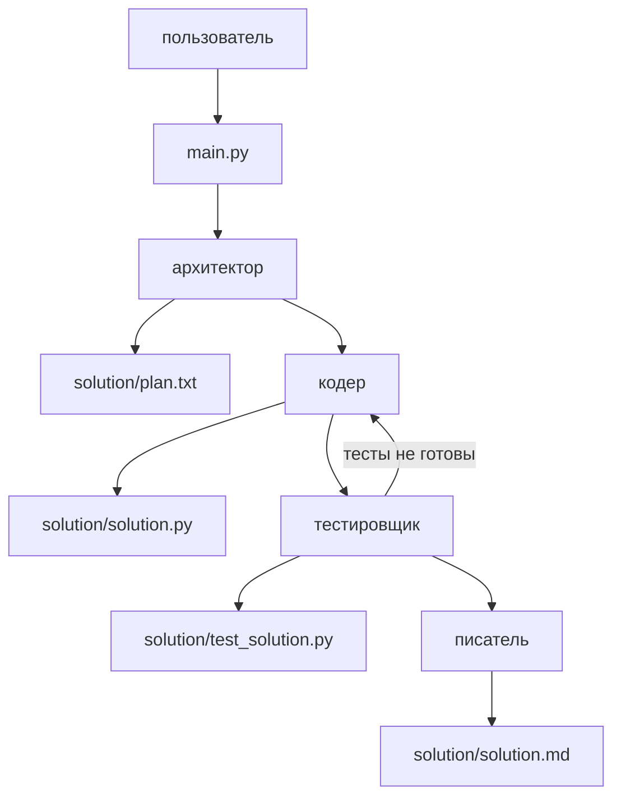

# Мультиагент

Модель `qwen2.5-coder:7b` через Ollama решает задачу в четыре шага. Поиска по чужому коду здесь нет: каждая роль пишет свою часть в папку `solution`.



- Архитектор пишет план в `solution/plan.txt` и не пишет код.
- Кодер пишет `solution/solution.py`.
- Тестировщик пишет `solution/test_solution.py` и запускает его. Если тестов нет, граф возвращается к кодеру.
- Писатель пишет `solution/solution.md`. Этот `README.md` он не трогает.

Инструменты: `read_file`, `write_file`, `execute_python`. Файлы сохраняются только внутри `solution/`.

## Запуск

Модель задана в `agents.py`. Отдельно указывать её не нужно. Ollama должна быть запущена, `qwen2.5-coder:7b` видна в `ollama list`.

```bash
cd learn_agent/ide
git checkout multi
python main.py
```

Текст задачи — переменная `user_task` внизу `main.py`. Сейчас это числа Фибоначчи с проверкой, что аргумент — положительное целое.

После завершения:

```bash
python solution/test_solution.py
```

В `solution/` должны быть `plan.txt`, `solution.py`, `test_solution.py` и `solution.md`.
