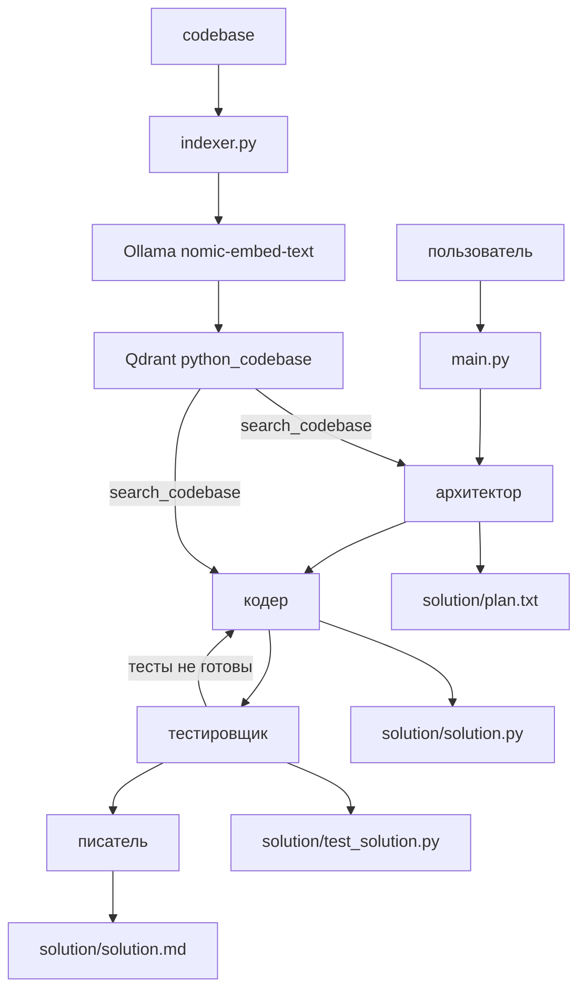

# Мультиагент с поиском по коду

Модель `qwen2.5-coder:7b` через Ollama решает задачу в четыре шага. Перед этим примеры из папки `codebase` лежат в Qdrant. Архитектор и кодер ищут там похожий код и опираются на него.



Все четыре файла появляются в папке `solution`.

## Что делает каждая роль

- Архитектор ищет похожие фрагменты в базе и пишет план в `solution/plan.txt`. Код он не пишет.
- Кодер по плану и найденным примерам пишет `solution/solution.py`.
- Тестировщик пишет `solution/test_solution.py` и запускает его. Если файла с тестами нет, сценарий возвращается к кодеру.
- Писатель пишет описание в `solution/solution.md`.

Инструменты у всех одни: `search_codebase`, `read_file`, `write_file`, `execute_python`. Запись идёт только внутрь `solution/`.

## Подготовка базы

Нужны запущенные Ollama и Qdrant. Модели: `qwen2.5-coder:7b` и `nomic-embed-text`.

```bash
cd path2project/ide
docker compose up -d
python indexer.py
```

`indexer.py` обходит `codebase/**/*.py`, режет файлы на куски и загружает их в коллекцию `python_codebase`. Повторный запуск обновляет те же точки.

## Запуск агента

Модель задана в `agents.py`.

```bash
cd /home/strike/work/external/learn/learn_agent/ide
python main.py
```

Текст задачи — переменная `user_task` внизу `main.py`. Сейчас это числа Фибоначчи с проверкой, что аргумент — положительное целое.

В терминале после каждого шага печатается статус. В конце в `solution/` должны быть:

- `plan.txt`
- `solution.py`
- `test_solution.py`
- `solution.md`

Проверка тестов отдельно:

```bash
python solution/test_solution.py
```
