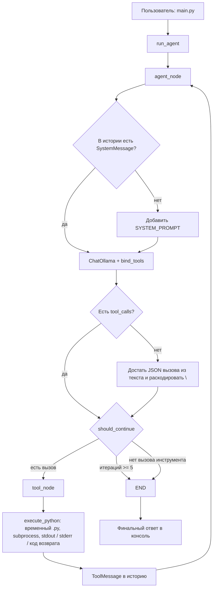

# Простой AI-агент для кода

Агент на LangGraph принимает задачу на естественном языке, пишет Python-код и проверяет его через инструмент `execute_python`. Модель — Ollama `qwen2.5-coder:7b`.

Запуск:

```bash
python main.py
```

`exit` завершает диалог.

## Схема



## Как устроен цикл

1. `main.py` читает строку и передаёт её в `run_agent`.
2. `agent_node` вызывает модель. Если в начале истории нет системного сообщения, подставляется `SYSTEM_PROMPT`.
3. Если модель не заполнила `tool_calls`, а написала JSON `{"name": "execute_python", "arguments": {...}}` в тексте, вызов извлекается из ответа. Последовательности `\n` в коде превращаются в переводы строк.
4. `should_continue` отправляет граф в `tool_node`, если есть вызов инструмента, и в `END`, если ответ текстовый или число итераций достигло 5.
5. `execute_python` пишет код во временный файл, запускает его и возвращает stdout, stderr и код возврата. Результат кладётся в историю как `ToolMessage`, после чего снова вызывается `agent_node`.

Состояние графа — список `messages`. Память диалога между запусками в одном процессе держит `MemorySaver` с `thread_id`.
