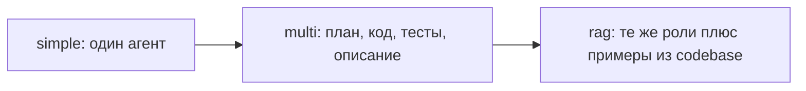

# Практическая работа. Один агент, несколько агентов, поиск по коду

Репозиторий: `learn_agent/ide`. Одна и та же задача проходит через три ветки. Готовый код не расширяем новой ролью: вы сами меняете ребро графа и видите, где «агент закончил» расходится с «код верный».

| Ветка | Что изучать | Как устроено |
| --- | --- | --- |
| `simple` | `main.py`, `agent.py`, `tools.py` | Один агент сам пишет код и запускает его |
| `multi` | `main.py`, `graph.py`, `agents.py`, `state.py`, `tools.py` | Четыре роли: план, код, тесты, описание |
| `rag` | файлы `multi` плюс `indexer.py`, `codebase/`, `docker-compose.yml` | Те же роли и поиск примеров в Qdrant |

Модель везде одна: Ollama `qwen2.5-coder:7b`. Для поиска по коду дополнительно нужна `nomic-embed-text`.



## Общая задача

На всех трёх ветках формулировка одна. На `simple` введите её в диалог. На `multi` и `rag` подставьте её в `user_task` внизу `main.py` вместо Фибоначчи.

```text
Напиши функцию positive_numbers(items).
Оставь только положительные целые числа.
Ноль, отрицательные и нецелые отвергни с ValueError.
Верни оставшиеся числа по возрастанию.
Проверь пустой список, ноль, отрицательное число и смесь значений.
```

На `simple` и `multi` агент пишет функцию сам. На `rag` в `codebase/utils/validators.py` и `codebase/algorithms/sorting.py` уже есть похожие куски. Сравнение трёх результатов показывает, зачем поиск, а не только то, что индекс загрузился.

Ollama должна быть запущена, модель `qwen2.5-coder:7b` видна в `ollama list`. Код репозитория меняйте только там, где это сказано в части.

## 1. Один агент

```bash
cd learn_agent/ide
git checkout simple
python main.py
```

В диалоге дайте общую задачу. `exit` завершает сессию.

Откройте `agent.py`. Цикл такой: `agent_node` вызывает модель, `tool_node` выполняет инструмент, `should_continue` решает, идти ли дальше. Потолок — `MAX_ITER`.

Дождитесь вызова `execute_python`. В отчёт положите кусок вывода этого инструмента, не весь лог.

Ответьте:

1. Где хранится история диалога и зачем она передаётся в следующий шаг?
2. Что делает агент, если модель напечатала вызов инструмента обычным JSON, а не через поле `tool_calls`?
3. Почему выполнение кода ограничено по времени?
4. Что произойдёт на шестой итерации?

Нарисуйте этот цикл в Mermaid. На схеме подпишите, сколько раз в вашем запуске модель вызывала инструмент.

## 2. Четыре роли и ребро графа

```bash
git checkout multi
```

В `main.py` замените `user_task` на общую задачу и запустите `python main.py`. В `solution/` должны появиться `plan.txt`, `solution.py`, `test_solution.py`, `solution.md`. Затем:

```bash
python solution/test_solution.py
```

В `graph.py` функция `route_after_tester` уходит к писателю, как только оба файла просто лежат на диске. Код выхода тестов при этом не читается.

Сделайте два прогона и сохраните оба списка файлов `solution/`.

1. Оставьте проверку «файлы существуют» как есть. Если тесты красные, а статус в терминале уже дошёл до писателя, запишите это: агент закончил, код неверный.
2. Уберите ранний переход к писателю по наличию файлов. К кодеру возвращайтесь, пока в последнем сообщении нет `exit code: 0` или `тесты пройдены` и счётчик `iteration` не превысил предел. Снова запустите `main.py`.

Ответьте:

1. Какое поле состояния показывает текущий шаг графа?
2. Почему код пишет кодер, а не архитектор?
3. После вашей правки какое условие отправляет поток к писателю, а какое возвращает к кодеру?
4. Какую работу один агент из части 1 делал сам и какая роль забрала её себе?

Нарисуйте четыре роли. Стрелкой отметьте возврат от тестировщика к кодеру после вашей правки.

## 3. Поиск по уже написанному коду

```bash
git checkout rag
```

Снова подставьте общую задачу в `user_task`. Поднимите базу и постройте индекс:

```bash
docker compose up -d
python indexer.py
```

`indexer.py` обходит `codebase/**/*.py`, режет файлы на куски и кладёт их в коллекцию `python_codebase`. Эмбеддинги считает `nomic-embed-text`.

Два запуска `python main.py`, два файла `solution/solution.py`.

1. Первый запуск — промпт архитектора в `agents.py` как в репозитории. Сохраните `solution.py` отдельно, например в `solution.py.before`.
2. В промпт архитектора допишите одну фразу: сначала вызвать `search_codebase`. Запустите снова.

Ответьте:

1. Зачем резать файл на куски, а не класть его в базу целиком?
2. Что архитектор и кодер спрашивают у базы через `search_codebase`?
3. Какие строки второго `solution.py` совпали с `codebase/utils/validators.py` или `codebase/algorithms/sorting.py`, а какие агент написал сам?
4. Что сломается, если Qdrant не запущен, а `python main.py` всё равно вызван?

Дополните схему из части 2 блоком: `codebase` → `indexer.py` → Qdrant → `search_codebase`.

## Что сдать

Не пересказывайте README. В отчёте четыре вещи:

- вывод `execute_python` с ветки `simple`;
- два списка файлов `solution/` с ветки `multi`: до правки `route_after_tester` и после;
- две версии `solution.py` с ветки `rag` и строки, совпавшие с `codebase/`;
- три схемы Mermaid: один агент, четыре роли с вашим ребром, те же роли плюс индекс.

В конце абзац: для какой постановки хватило одного агента и в какой поиск по своему коду изменил результат.
